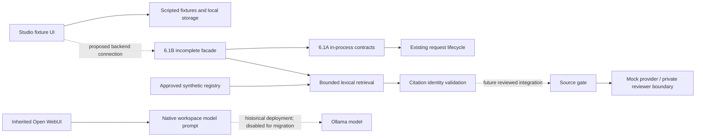

# System architecture
The source retains upstream paths: Svelte/TypeScript in src, FastAPI/Python in backend/open_webui. MORIQ prompt configuration is under moriq/brain; experimental enforcement is under moriq/brain/experimental/source_gate. The registry and retrieval code live in moriq/knowledge. offline_evaluation and synthetic_pilot are test infrastructure. offline_integration contains uncommitted 6.1A contracts and incomplete 6.1B facade work. studio-preview is a preserved, independently launched fixture UI.

Solid arrows describe recovered component code, not end-to-end acceptance. The 6.1B path is unfinished and its test errors are unresolved. Dashed connections are proposed or historical, never an instruction to activate them.

6.1A owns actor/session object capabilities, per-request cancellation and fixed no-text status responses. It registers with the existing lifecycle but does not resolve sources or invoke generation. Public output keeps sources empty, claim_status=not_assessed and release_allowed=false. Host-pinned references are not proof of current source approval. 6.1B adds an in-process byte/JSON facade and current reference checks against synthetic registry retrieval; it creates no listener. Trusted process memory, locks and synthetic identities are not production authentication.

Registry approval, exact-question applicability, citation identity, semantic claim review and answer release are separate gates. Revocation of a registry record cannot recall already returned copies. Killing a client worker does not prove an external model is idle. Future integration must preserve those distinctions.
